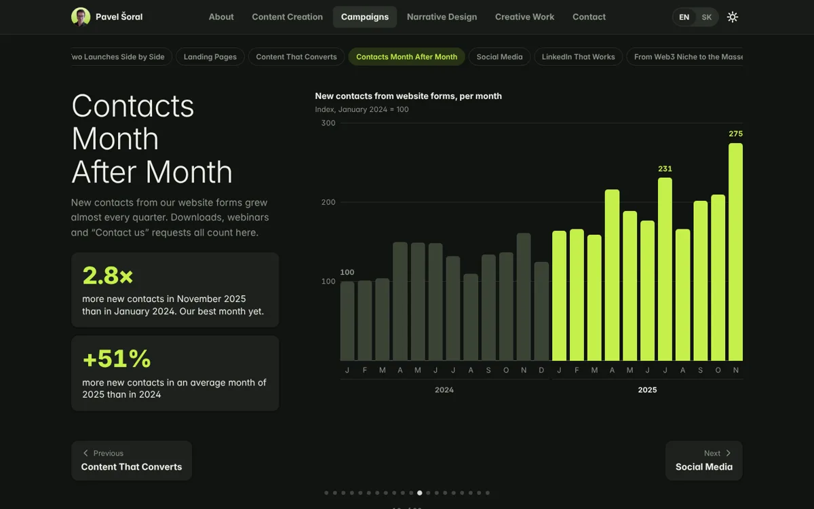

# Pavel Šoral · Portfolio

My portfolio as a small web app: content marketing, copywriting, campaigns, narrative design and a book debut.
It runs in any browser, works on phones, and has light and dark themes in English and Slovak.

**Live:** `https://<your-user>.github.io/<repo-name>/` (see [Deploy](#deploy))


## What’s inside

- **One page per section:** About, Content Creation, Campaigns, Narrative Design and Creative Work, the same
  sections as the PDF portfolio. Each page is one long scroll of blocks (20 in total), with a sticky row of chips to
  jump between them. Every page ends with the same Contact Me block, which the Contact menu item scrolls to.
- **Animated results:** bars grow and numbers count up when they scroll into view. Hover or focus a bar to read its value.
  Every chart also has a hidden data table for screen readers.
- **Documents open in place:** Google Drive files and folders (case studies, magazines, storylines) open in a built-in
  preview. Other articles open on their original site in a new tab.
- **Two languages:** English and Slovak, with a toggle in the header. `?lang=sk` in the URL opens the Slovak version.
- **Light and dark themes** with a toggle; the choice is remembered.
- **Keyboard friendly:** ← and → move between sections, every control has a visible focus state, and motion is turned off
  for people who ask their system to reduce it.




## How it’s built

No framework, no build step, no dependencies. Open `index.html` through any static server and it works.

```
index.html              page shell
404.html                sends unknown URLs back to the start
content/content.js      all text, links and image references (EN + SK)
assets/js/app.js        router, page renderers, charts, document preview
assets/css/style.css    design tokens and components
assets/icons.svg        16 px symbolic icon set
assets/img/             WebP images (about 1.6 MB in total, lazy-loaded)
assets/fonts/           Inter, subset to Latin + Central European characters
.github/workflows/      GitHub Pages deployment
```

The look follows GNOME’s Adwaita conventions (header bar with a view switcher, boxed lists, cards, pill buttons)
with my own “Lime Signal” palette. Links use the hash: `#campaigns` opens a section from the top, `#contacts-growth`
opens its section and scrolls to that block, and `#contact` scrolls to the contact block. Every block can be linked
directly, and the site works on any static host without server rules.

## Run it locally

```sh
git clone https://github.com/<your-user>/<repo-name>.git
cd <repo-name>
python3 -m http.server 8000
# open http://localhost:8000
```

## Edit the content

Everything you read on the site lives in `content/content.js`. A text value is either a plain string (the same in
both languages) or a pair:

```js
"title": { "en": "Blog Posts", "sk": "Blogové články" }
```

**Links still to fill in** (`config` at the top of `content/content.js`):

| Key | Shows |
|---|---|
| `linkedin` | the LinkedIn row on the Contact page |
| `repo` | the “Source code on GitHub” link in the footer |
| `phone` | a phone row on the Contact page (left empty on purpose for a public site) |
| `links.blogs`, `links.cases`, `links.product`, `links.ebooks`, `links.landing`, `links.social`, `links.story` | the green buttons on the matching blocks; a button stays hidden until its link is set |

Google Drive links open in the built-in preview only when the file or folder is shared as
**Anyone with the link → Viewer**. Otherwise the preview stays empty and visitors use “Open in a new tab”.

## Deploy

1. Create a public repository on GitHub and push this folder to the `main` branch.
2. In the repository, open **Settings → Pages** and set **Source** to **GitHub Actions**.
3. The workflow in `.github/workflows/pages.yml` publishes the site on every push to `main`.

## Licenses

- **Code** (`index.html`, `404.html`, `assets/js/`, `assets/css/`, `assets/icons.svg`, `.github/`): MIT, see `LICENSE`.
- **Fonts** (`assets/fonts/`): Inter by The Inter Project Authors, SIL Open Font License 1.1, see `assets/fonts/OFL.txt`.
- **Content** (`content/`, `assets/img/`, `docs/`): © Pavel Šoral and the respective owners. Not covered by the MIT
  license. Work samples, screenshots and product images belong to the companies I created them for (Photoneo,
  now part of Zebra Technologies; QORPO; Slido; Foliovision; Immutable; Interez Media) and are shown here as a
  portfolio of my work. Product and company names are trademarks of their owners.
- The visual style is inspired by GNOME’s Adwaita. This project is not affiliated with or endorsed by the GNOME
  Foundation, Canonical or any company named above.

## Contact

pavel.soral@proton.me
