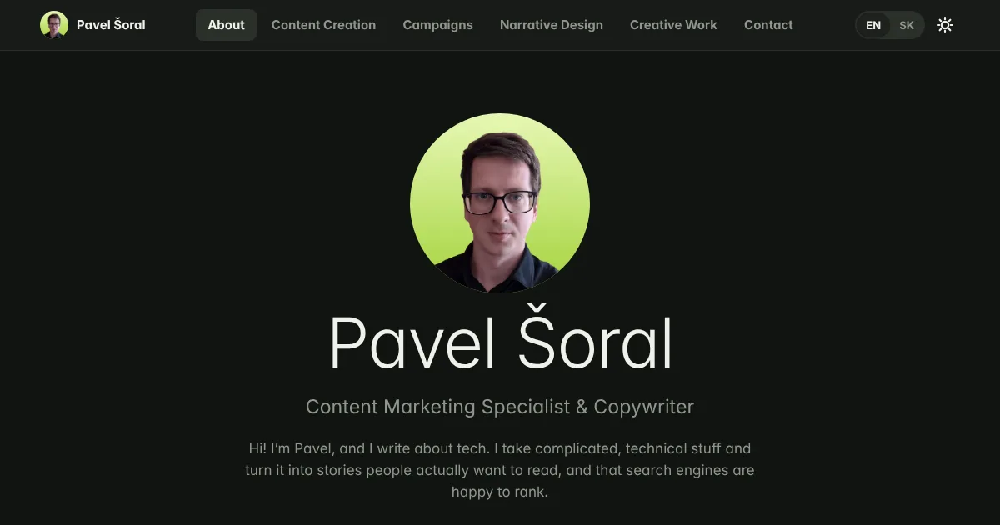
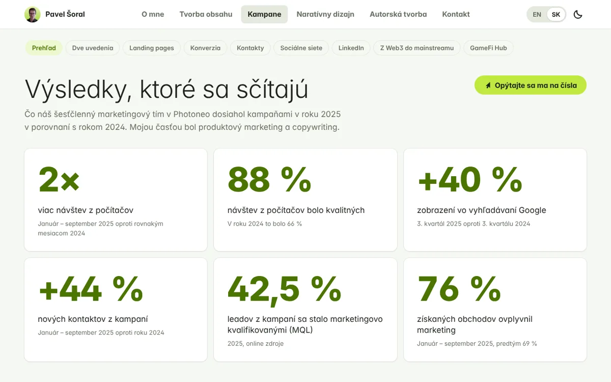

# Pavel Šoral · Portfolio

My portfolio as a small web app: content marketing, copywriting, campaigns, narrative design and a book debut.
It runs in any browser, works on phones, and has light and dark themes in English and Slovak.

**Live:** https://pavel-soral.github.io



## What’s inside

- **One page per section:** About, Content Creation, Campaigns, Narrative Design and Creative Work, the same
  sections as the PDF portfolio. Each page is one long scroll of blocks (19 in total), with a sticky row of chips to
  jump between them. Every page ends with the same Contact Me block, which the Contact menu item scrolls to.
- **Animated results:** numbers count up when they scroll into view. Bar charts are supported too (see `barchart` and
  `hbars` in `assets/js/app.js`).
- **Documents open in place:** the case studies, brochures and one-pager (PDFs in `assets/docs/`) and Google Drive
  files open in a built-in preview. On phones, PDFs open in the browser’s own viewer. Other articles open on their original site in a new tab.
- **Two languages:** English and Slovak, with a toggle in the header. `?lang=sk` in the URL opens the Slovak version.
- **Light and dark themes** with a toggle; the choice is remembered.
- **Keyboard friendly:** ← and → move between sections, every control has a visible focus state, and motion is turned off
  for people who ask their system to reduce it.



## How it’s built

No framework, no build step, no dependencies. Open `index.html` through any static server and it works.

```
index.html              page shell
404.html                sends unknown URLs back to the start
content/content.js      all text, links and image references (EN + SK)
assets/js/app.js        router, page renderers, charts, document preview
assets/css/style.css    design tokens and components
assets/icons.svg        16 px symbolic icon set
assets/img/             WebP images (about 1.9 MB in total, lazy-loaded)
assets/docs/            case studies, brochures and the Aurora VGR Studio one-pager (PDF)
assets/fonts/           Inter, subset to Latin + Central European characters
.github/workflows/      GitHub Pages deployment and the snap build
desktop/portfolio.py    desktop app: the site in a GTK window (WebKitGTK)
desktop/make_english.py makes the English-only copy the desktop app ships
snap/                   snap package recipe, desktop entry and icon
```

The look follows GNOME’s Adwaita conventions (header bar with a view switcher, boxed lists, cards, pill buttons)
with my own “Lime Signal” palette. Links use the hash: `#campaigns` opens a section from the top, `#linkedin`
opens its section and scrolls to that block, and `#contact` scrolls to the contact block. Every block can be linked
directly, and the site works on any static host without server rules.

## Run it locally

```sh
git clone https://github.com/Pavel-Soral/pavel-soral.github.io.git
cd pavel-soral.github.io
python3 -m http.server 8000
# open http://localhost:8000
```

## Edit the content

Everything you read on the site lives in `content/content.js`. A text value is either a plain string (the same in
both languages) or a pair:

```js
"title": { "en": "Blog Posts", "sk": "Blogové články" }
```

**Links still to fill in** (`config` at the top of `content/content.js`):

| Key | Shows |
|---|---|
| `linkedin` | the LinkedIn row on the Contact page |
| `repo` | the “Source code on GitHub” link in the footer |
| `phone` | a phone row on the Contact page (left empty on purpose for a public site) |
| `links.blogs`, `links.cases`, `links.product`, `links.ebooks`, `links.landing`, `links.social`, `links.story`, `links.webinars` | the green buttons on the matching blocks; a button stays hidden until its link is set |

Google Drive links open in the built-in preview only when the file or folder is shared as
**Anyone with the link → Viewer**. Otherwise the preview stays empty and visitors use “Open in a new tab”.

## Deploy

1. Create a public repository on GitHub and push this folder to the `main` branch.
2. In the repository, open **Settings → Pages** and set **Source** to **GitHub Actions**.
3. The workflow in `.github/workflows/pages.yml` publishes the site on every push to `main`.

## Desktop app (snap)

The same portfolio, English only, as a desktop app for Ubuntu and other Linux systems. It is a small
Python app that shows the site in a native GNOME window (GTK 3 and WebKitGTK from the GNOME platform snap).

- **Back and forward buttons** in the window’s header bar follow your clicks through the site
  (also Alt+← and Alt+→). The header bar switches between dark and light together with the page.
- **Links to articles and landing pages open in your browser**; email links open your mail app.
  Google Drive documents open in the preview inside the app.
- **Shortcuts:** Ctrl+R reload, F11 full screen, Ctrl+Q quit.

**Try it from a checkout**, without the snap:

```sh
# Ubuntu / Debian
sudo apt install gir1.2-webkit2-4.1 python3-gi
# openSUSE Tumbleweed
sudo zypper install python3-gobject python3-gobject-Gdk typelib-1_0-Gtk-3_0 typelib-1_0-WebKit2-4_1

python3 desktop/portfolio.py
```

**Build the snap** on your own machine:

```sh
sudo snap install snapcraft --classic
snapcraft                                   # builds in an LXD container
sudo snap install --dangerous ./pavel-soral-portfolio_1.0.0_amd64.snap
pavel-soral-portfolio
```

Every push to `main` also builds the snap on GitHub (`.github/workflows/snap.yml`); download it from the
run’s **Artifacts**.

**Publish to the Snap Store:**

1. Create an Ubuntu One account and register the name: `snapcraft register pavel-soral-portfolio`.
2. Create credentials and add them to the repository as the secret `SNAPCRAFT_STORE_CREDENTIALS`:
   `snapcraft export-login --snaps=pavel-soral-portfolio --acls package_access,package_push,package_update,package_release -`
3. Push a tag such as `v1.0.0`. The workflow builds the snap and releases it to the stable channel.
   Then anyone can run `sudo snap install pavel-soral-portfolio`.

Change `version` in `snap/snapcraft.yaml` for each release.

## Licenses

- **Code** (`index.html`, `404.html`, `assets/js/`, `assets/css/`, `assets/icons.svg`, `desktop/`, `snap/`, `.github/`):
  GNU General Public License v3.0 or later, see `LICENSE`. You may use, change and share it, as long as what you
  share stays under the same license and comes with its source code.
- **Fonts** (`assets/fonts/`): Inter by The Inter Project Authors, SIL Open Font License 1.1, see `assets/fonts/OFL.txt`.
- **Content** (`content/`, `assets/img/`, `docs/`): © Pavel Šoral and the respective owners. Not covered by the GPL. Work samples, screenshots and product images belong to the companies I created them for (Photoneo,
  now part of Zebra Technologies; QORPO; Slido; Foliovision; Immutable; Interez Media) and are shown here as a
  portfolio of my work. Product and company names are trademarks of their owners.
- The visual style is inspired by GNOME’s Adwaita. This project is not affiliated with or endorsed by the GNOME
  Foundation, Canonical or any company named above.

## Contact

pavel.soral@proton.me
